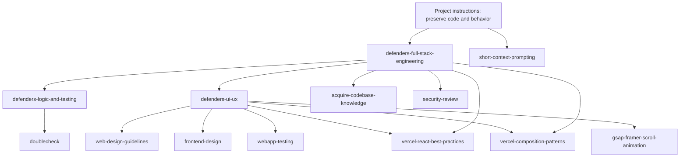

# Defenders Academy skill graph

Use the central project skill for changes that cross layers. Add the focused logic or UI/UX skill when the change needs those perspectives; existing framework skills provide deeper, reusable guidance.

## Skill coverage

| Skill | Use for |
|---|---|
| [defenders-full-stack-engineering](./defenders-full-stack-engineering/SKILL.md) | TypeScript/JavaScript, React/Next.js, Express, Prisma/PostgreSQL, CSS/Tailwind, HTML/JSX, SQL, JSON/YAML, Docker, and cross-layer changes |
| [defenders-logic-and-testing](./defenders-logic-and-testing/SKILL.md) | Business rules, state transitions, validation, API/database contracts, edge cases, and test design |
| [defenders-ui-ux](./defenders-ui-ux/SKILL.md) | Responsive UI, accessibility, RTL, three-language content, interaction design, reduced motion, and visual consistency |
| [vercel-react-best-practices](./vercel-react-best-practices/SKILL.md) | React/Next.js performance and rendering patterns |
| [vercel-composition-patterns](./vercel-composition-patterns/SKILL.md) | Reusable React component APIs and composition |
| [web-design-guidelines](./web-design-guidelines/SKILL.md) | On-demand interface and accessibility review |
| [frontend-design](./frontend-design/SKILL.md) | Distinctive, brief-specific visual design and UI critique ([source](https://github.com/anthropics/skills)) |
| [webapp-testing](./webapp-testing/SKILL.md) | Browser-based interaction, responsive, and frontend verification ([source](https://github.com/github/awesome-copilot)) |
| [acquire-codebase-knowledge](./acquire-codebase-knowledge/SKILL.md) | Evidence-based codebase mapping and onboarding documentation ([source](https://github.com/github/awesome-copilot)) |
| [security-review](./security-review/SKILL.md) | Requested security reviews and vulnerability analysis ([source](https://github.com/github/awesome-copilot)) |
| [doublecheck](./doublecheck/SKILL.md) | Verification of factual claims and AI-generated output ([source](https://github.com/github/awesome-copilot)) |
| [gsap-framer-scroll-animation](./gsap-framer-scroll-animation/SKILL.md) | Scroll-linked and timeline animation implementation |
| [short-context-prompting](./short-context-prompting/SKILL.md) | Focused Copilot context and VS Code prompting |

The existing React performance and web-design review skills already cover the overlapping React best-practices and web-design-guidelines recommendations; avoid installing duplicate copies.

Skills are guidance, not a substitute for reading the code. Load only the relevant skills for a task; preserve the repository's existing behavior and verify changes against its actual scripts and constraints.
