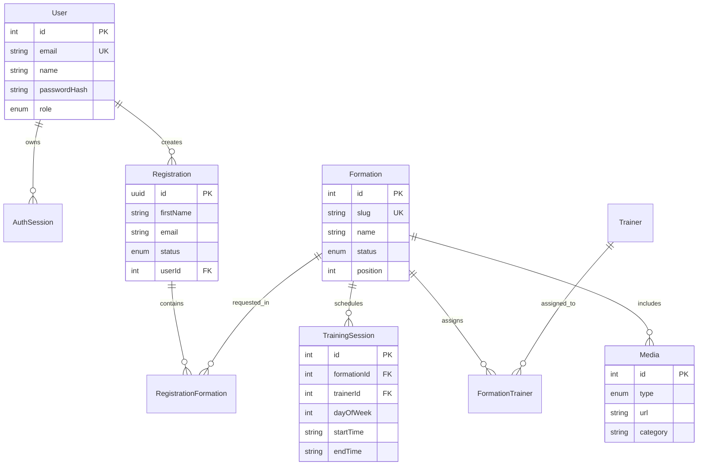

# Cahier des Charges - Defenders Fitness Academy

## 0. Informations du document

| Élément | Information |
|---|---|
| Projet | Defenders Fitness Academy |
| Version | 1.0 |
| Date | 5 novembre 2026 |
| Statut | Baseline pour analyse et mise en production |
| Branche analysée | `ayoubtasks` |
| Clients métier | Defenders Fitness Academy / Defenders Academy |
| Usages principaux | Présentation des formations, inscriptions, espace client, administration |

Ce document est basé sur l'analyse du dépôt, des composants frontend, du backend, du schéma Prisma, des routes API, du Docker Compose et de l'état de déploiement local.

## 1. Présentation générale

### 1.1 Contexte

Defenders Fitness Academy est un centre proposant des formations certifiantes en Pilates, Football et Personal Training. Le projet numérique doit permettre de présenter les offres, recueillir les demandes d'inscription, gérer les comptes clients et administrateurs, publier les sessions de formation et administrer les inscriptions.

### 1.2 Problématique

Les informations commerciales sont réparties entre les réseaux sociaux, les contacts WhatsApp et les formulaires manuels. Le site vise à centraliser la présentation des formations, le planning, les demandes d'inscription, la confirmation automatique par e-mail et le suivi administratif.

### 1.3 Objectifs

1. Présenter professionnellement les formations et le centre.
2. Permettre une demande d'inscription simple et accessible.
3. Envoyer automatiquement les notifications administrateur et les confirmations clients.
4. Permettre aux administrateurs de gérer les demandes, les formations, les médias et les statuts.
5. Permettre aux clients de suivre leurs inscriptions.
6. Préparer une mise en production fiable, sécurisée et maintenable.

### 1.4 Public cible

- Coachs professionnels
- Jeunes diplômés en sciences du sport
- Étudiants
- Personnes en reconversion
- Administrateurs du centre
- Clients inscrits

### 1.5 Parties prenantes

| Partie prenante | Responsabilité |
|---|---|
| Direction de Defenders | Validation métier, contenus et politique commerciale |
| Formateurs | Validation des programmes et créneaux |
| Administrateur site | Gestion des demandes, utilisateurs, formations et contenus |
| Client/visiteur | Consultation, inscription, suivi |
| Développeur/maintenance | Développement, sécurité, déploiement, exploitation |

## 2. Analyse des besoins

### 2.1 Besoins fonctionnels

| ID | Besoin |
|---|---|
| BF-01 | Afficher la page d'accueil, les formations, le planning, les partenaires, la galerie et les informations de Security Protection |
| BF-02 | Permettre la création d'un compte client |
| BF-03 | Permettre la connexion et la déconnexion |
| BF-04 | Permettre l'envoi d'une demande d'inscription |
| BF-05 | Permettre l'ajout d'une pièce jointe PDF/JPG/PNG jusqu'à 5 Mo |
| BF-06 | Envoyer un e-mail de notification à l'administrateur |
| BF-07 | Envoyer une confirmation personnalisée au candidat |
| BF-08 | Permettre l'association de la demande à un compte client |
| BF-09 | Permettre à un client de consulter ses inscriptions |
| BF-10 | Permettre à un administrateur de consulter les demandes et leurs compteurs |
| BF-11 | Permettre à un administrateur de changer le statut d'une demande |
| BF-12 | Permettre la gestion des formations et des médias |
| BF-13 | Fournir les pages juridiques et les ressources SEO |
| BF-14 | Permettre la réservation ou le redirection vers le formulaire de contact |

### 2.2 Besoins non fonctionnels

- Disponibilité cible en production : 99,9 % hors maintenance planifiée
- Temps de réponse API cible : inférieur à 500 ms pour les opérations simples hors SMTP
- Site responsive sur mobile, tablette et ordinateur
- Interface disponible principalement en français
- Dégradation gracieuse si l'envoi SMTP échoue
- Sauvegarde quotidienne de PostgreSQL
- Journalisation des erreurs serveur et des opérations critiques
- Chiffrement HTTPS obligatoire
- Secrets exclus du dépôt Git
- Validation côté frontend, API et base de données

### 2.3 Contraintes

- Frontend Next.js 16, React 19 et Tailwind CSS 4
- Backend Express 5, TypeScript et Prisma 7
- PostgreSQL 17
- Déploiement Docker Compose
- SMTP Gmail avec App Password
- Hébergement et domaine à fournir par le client
- Envoi possible uniquement vers des adresses valides
- Pièces jointes limitées à 5 Mo et à PDF/JPG/PNG

## 3. Stack technique actuelle

| Composant | Technologie |
|---|---|
| Frontend | Next.js 16.4.5, React 19, TypeScript, Tailwind CSS 4 |
| UI | Radix UI, composants personnalisés |
| Animations | GSAP, Anime.js |
| Backend | Node.js 24, Express 5, TypeScript, Zod, Prisma 7 |
| Base de données | PostgreSQL 17 |
| E-mails | Nodemailer, SMTP Gmail |
| Conteneurs | Docker / Docker Compose |
| Authentification | Token de session stocké côté serveur, empreinte SHA-256 en base |
| Reverse proxy recommandé | Nginx ou Traefik |
| DNS/CDN/WAF recommandé | Cloudflare |

## 4. Acteurs et permissions

| Fonctionnalité | Visiteur | Client | Administrateur |
|---|---:|---:|---:|
| Consulter le site | Oui | Oui | Oui |
| Envoyer une demande | Oui* | Oui | Oui |
| Créer un compte | Oui | Non | Non |
| Se connecter | Oui | Oui | Oui |
| Voir ses inscriptions | Non | Oui | Oui |
| Voir toutes les inscriptions | Non | Non | Oui |
| Modifier le statut d'une demande | Non | Non | Oui |
| Gérer les formations | Non | Non | Oui |
| Gérer les médias | Non | Non | Oui |
| Accéder aux pages utilisateurs | Dépend du cas | Oui | Oui |

\* Le formulaire public doit rester accessible sans obligation de compte. Un compte facultatif est une recommandation UX, pas une interdiction.

## 5. Spécifications fonctionnelles prioritaires

### FR-001 - Envoi d'une demande

| Élément | Description |
|---|---|
| Acteur | Visiteur ou client connecté |
| Préconditions | Formation disponible, formulaire chargé |
| Scénario nominal | Renseigner coordonnées, profil, formations, disponibilité, consentement et message |
| Exceptions | Champs invalides, pièce jointe invalide, spam, SMTP indisponible |
| Résultat attendu | Demande sauvegardée, accusé utilisateur, notification administrateur si SMTP disponible |
| Priorité | Must Have |

### FR-002 - Authentification

| Élément | Description |
|---|---|
| Acteur | Client ou administrateur |
| Préconditions | Compte existant |
| Scénario nominal | Saisir e-mail et mot de passe, recevoir une session valide |
| Exceptions | Identifiants invalides, compte absent, compte bloqué |
| Résultat attendu | Redirection vers la page demandée ou l'administration |
| Priorité | Must Have |

### FR-003 - Gestion des inscriptions

| Élément | Description |
|---|---|
| Acteur | Administrateur |
| Préconditions | Demande existante |
| Scénario nominal | Filtrer les demandes puis modifier le statut |
| Exceptions | Demande supprimée ou permissions insuffisantes |
| Résultat attendu | Statut enregistré et visible dans les listes |
| Priorité | Must Have |

### FR-004 - E-mails transactionnels

| Élément | Description |
|---|---|
| Acteur | Système |
| Préconditions | SMTP configuré, adresse destinataire valide |
| Scénario nominal | Envoyer l'e-mail administrateur puis la confirmation client |
| Exceptions | SMTP indisponible ou identifiants invalides |
| Résultat attendu | Demande conservée, succès enregistré et journalisé |
| Priorité | Must Have |

## 6. Modèle de données



## 7. Architecture cible en production

```text
Internet
  |
  | HTTPS 443
  v
Cloudflare DNS + WAF/CDN
  |
  v
Nginx / Traefik Reverse Proxy
  |
  +--> Next.js Frontend :3000
  |
  +--> Express API :4000
         |
         +--> PostgreSQL 17
         +--> SMTP transactionnel
         +--> Volume sauvegardes
         +--> Stockage médias
```

## 8. Sécurité et conformité

Obligations :

- HTTPS sur tous les domaines et sous-domaines.
- Secrets déplacés vers les variables d'environnement du serveur ou un gestionnaire de secrets.
- Rotation régulière des mots de passe App Password Gmail.
- Mots de passe utilisateur hashés.
- Sessions stockées par empreinte et expirées.
- Validation Zod côté API.
- Corps JSON limité, avec limite spécifique pour le formulaire.
- Helmet, CORS restreint, cookies sécurisés.
- Honeypot anti-spam.
- Rate limiting sur les actions sensibles.
- Sauvegarde chiffrée PostgreSQL.
- Sauvegarde des pièces et contenus hors hébergement éphémère.
- Logs sans mots de passe, jetons ou pièces jointes.
- Politique de confidentialité, mentions légales et cookies.

## 9. Points bloquants identifiés avant lancement

| ID | Problème | Sévérité | Décision requise |
|---|---|---|---|
| BL-01 | Le proxy exige une session et redirige toute page vers `/login`, sauf exceptions statiques | Critique | Confirmer si le site public doit rester accessible sans connexion |
| BL-02 | Aucun script de test automatisé identifié | Élevée | Ajouter tests unitaires, API et E2E |
| BL-03 | Monitoring et alertes absents dans Docker Compose | Élevée | Ajouter Uptime Kuma ou service externe |
| BL-04 | Sauvegardes PostgreSQL automatisées absentes | Élevée | Planifier dump quotidien, test de restauration |
| BL-05 | Domaine production non configuré | Élevée | Choisir et acheter le domaine |
| BL-06 | Environnement staging absent | Moyenne | Créer un sous-domaine de préproduction |
| BL-07 | Secrets SMTP App Password potentiellement exposés dans les échanges | Critique | Révoquer puis remplacer l'ancien App Password |
| BL-08 | Cookies et session doivent être vérifiés en production avec le reverse proxy | Élevée | Définir domaines, secure cookies, CORS et trust proxy |

## 10. Critères d'acceptation

- Toutes les pages publiques répondent en HTTPS.
- Login, inscription, déconnexion et espace client sont testés.
- Une demande crée un enregistrement PostgreSQL.
- Les deux e-mails sont envoyés ou l'échec est journalisé sans perte de la demande.
- Le logo apparaît dans les e-mails compatibles.
- Une pièce jointe est envoyée sans être persistée en base.
- Les routes administrateur refusent les visiteurs et clients.
- Le planning, les formations et les médias s'affichent correctement.
- Mobile, tablette et desktop sont validés.
- Sauvegarde et restauration sont testées.
- Aucun secret n'est présent dans Git.
- Build frontend, build backend et migrations passent sur une machine vierge.

## 11. Planning recommandé

| Phase | Durée indicative | Livrables |
|---|---|---|
| Correction lancement | 3 à 5 jours | Accès public, secrets, SMTP, bugs critiques |
| Sécurité et exploitation | 3 à 5 jours | Sauvegarde, monitoring, logs, HTTPS |
| QA | 4 à 7 jours | Tests API/E2E/responsive/performance |
| Preproduction | 2 à 3 jours | Domaine staging, recette et corrections |
| Production | 1 à 2 jours | DNS, migration, monitoring et validation |

## 12. Livrables attendus

- Cahier des charges validé
- SRS détaillé
- Architecture et modèle de données
- API documentée
- Test Plan et critères d'acceptation
- Guide de déploiement
- Guide utilisateur
- Plan de sauvegarde et de reprise
- Procédure de maintenance et de mise à jour
